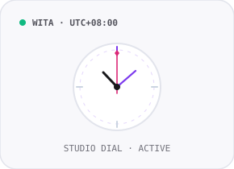
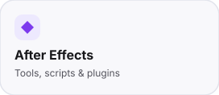
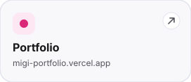
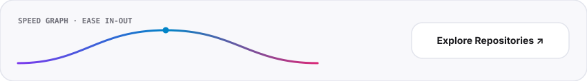

<!-- Top Row: Studio Hero (64%) + Animated UTC+8 Dial (34%) -->
<picture><source media="(prefers-color-scheme: dark)" srcset="assets/studio-hero-dark.svg?v=3"></picture>&nbsp;<picture><source media="(prefers-color-scheme: dark)" srcset="assets/studio-clock-dark.svg"></picture>

<!-- Middle Row: 3-Column Bento -->
<picture><source media="(prefers-color-scheme: dark)" srcset="assets/focus-ae-dark.svg"></picture>&nbsp;<a href="https://github.com/Genesfi/focusgrowrust"><picture><source media="(prefers-color-scheme: dark)" srcset="assets/focus-rust-dark.svg?v=3"></picture></a>&nbsp;<a href="https://migi-portfolio.vercel.app/"><picture><source media="(prefers-color-scheme: dark)" srcset="assets/focus-links-dark.svg"></picture></a>

<!-- Bottom Row: Motion Curve & Repositories -->
<a href="https://github.com/Genesfi?tab=repositories"><picture><source media="(prefers-color-scheme: dark)" srcset="assets/timeline-dark.svg"></picture></a>

