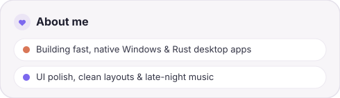
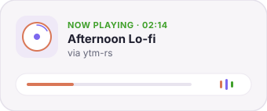
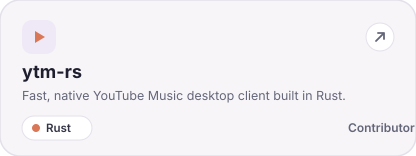
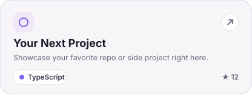
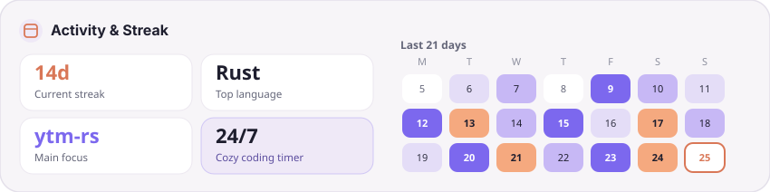

<picture><source media="(prefers-color-scheme: dark)" srcset="assets/hero-dark.svg"></picture>

<picture><source media="(prefers-color-scheme: dark)" srcset="assets/about-dark.svg"></picture>&nbsp;<a href="https://github.com/grapedjuice/ytm-rs"><picture><source media="(prefers-color-scheme: dark)" srcset="assets/music-dark.svg"></picture></a>

<a href="https://github.com/grapedjuice/ytm-rs"><picture><source media="(prefers-color-scheme: dark)" srcset="assets/project-ytmrs-dark.svg"></picture></a>&nbsp;<a href="https://migi-portfolio.vercel.app/"><picture><source media="(prefers-color-scheme: dark)" srcset="assets/project-two-dark.svg"></picture></a>

<picture><source media="(prefers-color-scheme: dark)" srcset="assets/calendar-dark.svg"></picture>

<picture><source media="(prefers-color-scheme: dark)" srcset="assets/wave-dark.svg"></picture>

<a href="https://github.com/Genesfi?tab=repositories"><picture><source media="(prefers-color-scheme: dark)" srcset="assets/cta-dark.svg"></picture></a>

